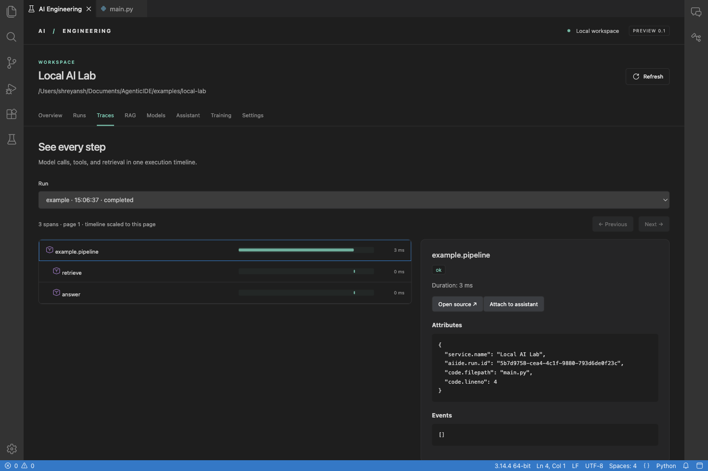

# AI Engineering IDE

A local-first Theia/Electron desktop IDE for Python AI engineering. The editor, terminals, Python tooling, Git, coding assistant, RAG tools, run history, and trace viewer share one workspace.

This repository is an implemented **0.2.1 developer preview**, not a completed or production-certified version of every roadmap milestone. The [implementation status](docs/implementation.md) distinguishes working features from remaining work and records validation limits.



## Start the installed development workspace

```sh
npm run demo
```

The demo opens `examples/local-lab`. Trust the local example when prompted; the workspace opens on **Home**. Then choose **Runs → Run locally → Trace ↗**. It uses Python 3, requires no model or account, and produces a real nested trace through the managed OpenTelemetry Collector. Completed traces survive restarting the IDE.

To return to your work, open the same project folder using **Open recent…** or **Open folder…** on the AI Engineering start screen. The AI Engineering tab opens on startup, including when restoring a previous layout. If you close it, click **AI Engineering** in the bottom status bar, choose **View → Open AI Engineering**, or press **⌘⌥E** on macOS (**Ctrl+Alt+E** on Windows/Linux). Trusted projects open straight to **Home**, which shows workflow progress and recent runs; **View previous runs** lists everything. Each run's **Trace** action opens its recorded steps.

To open your own project:

```sh
npm start -- /absolute/path/to/project
```

The unsigned macOS Apple Silicon installer is built into `dist/0.2.1/AI Engineering IDE-0.2.1-arm64.dmg`. This is a development build, without Apple notarization. Linux packaging is configured in CI but must be validated on a Linux machine before a supported Linux release.

## Build from a clean checkout

Requirements: Node 24, npm, Python 3, `uv`, `unzip`, and platform C/C++ build tools for Theia's native dependencies. Docker is required for managed Qdrant and autonomous agent commands, but not for editing, chat, or ordinary local runs. Linux also needs a running Secret Service keyring for credential storage.

```sh
npm ci
npm run collector:install
npm run extensions:install
npm run build
npm run demo
```

Install scripts download pinned artifacts and verify checksums. The Collector and unpacked Git, Python, basedpyright, and debugpy extensions are included in packaged builds. Python template lockfiles are committed; model weights are never downloaded automatically. Docker images download when their feature is first started.

```sh
npm run package             # build and package for the current platform
npm run build:browser       # optional browser development target
npm run start:browser -- /absolute/project --port=3080
```

The browser target is for local development. It is not a hosted or multi-user deployment. Each workspace can be opened by one AIIDE backend process at a time.

## Create an AI project

1. Open a parent folder and use **Home → Create a project from a template**. Templates include generic Python, LangGraph, LangChain/Qdrant RAG, PyTorch training, scikit-learn, and local PEFT fine-tuning.
2. In **Runs**, select `setup` to install the locked environment. Then select `example`.
3. For model-dependent templates, configure model connections below and select them in **Settings → Template chat model / Template embedding model / Template vector database**. Save settings before running.
4. Inspect spans, events, evaluations, and metrics in **Runs** and **Traces**. Enable content capture in Settings if you want persisted prompt, response, log, document, or graph-state content.

Existing projects retain their lockfiles and environment. Set the Python executable and named command argument arrays in Settings. **Add an integration** resolves a staged `uv` manifest/lockfile change and displays it before installation. LangChain/LangGraph additions include a callback helper; pass it into your chain or graph. Poetry/Pipenv projects are detected but must install packages using their existing manager. Arbitrary projects are not silently instrumented.

## Connect local models

In **Build → Models & playground**, pick a preset (Ollama, LM Studio, vLLM, llama.cpp, or an HTTPS OpenAI-compatible API) or enter the API base URL, model name, and optional API key. For Ollama's compatible API, use `http://localhost:11434/v1`. Add a separate connection for an embedding model. Other OpenAI-compatible endpoints are supported; remote connections require HTTPS.

Run **Test capabilities**. Chat, streaming, tool calls, and embeddings are tested independently. The **Inference playground** on the same page sends multi-turn prompts with an optional system prompt, temperature, and max tokens, and shows latency, token counts, throughput, and estimated cost. A chat-only model can answer questions and suggest patches. Autonomous execution requires a successful tool-call test and Docker. Model connections are also registered with Theia AI.

Keys live in the OS credential store. The project stores only connection IDs and credential references. No plaintext fallback is used if the keyring is unavailable. Changing an endpoint does not reuse its old credential automatically.

## RAG workflow

1. Put a UTF-8 `.txt` or `.md` document in the workspace.
2. In **RAG**, start managed local Qdrant, or connect an existing server through Settings.
3. Select the vector database and embedding connection, choose a collection, and preview chunk boundaries.
4. Choose **Embed & ingest**. The IDE checks embedding dimensions and stores model, chunking, and source provenance alongside each chunk.
5. Enter a question and choose **Retrieve**, optionally with an answer model. Inspect scored chunks, metadata, and the answer. Each operation produces a run and trace.
6. Evaluate a JSONL dataset, then compare the resulting runs and evaluation events.

Example evaluation case:

```json
{"input":"Where is telemetry stored?","expected":"local","match":"contains"}
```

`match` can be `contains` or `exact`; optional judge-model scoring is separate. Local Qdrant uses a dynamically assigned loopback port and persistent storage under `.aiide/qdrant`. Stopping the server does not delete its data. The RAG panel shows document content deliberately; the telemetry content setting controls persisted telemetry, not the database's required document payload.

## Coding assistant and external agents

**Codex and Claude Code:** open **Build → External agents** for scoped credentials, client launch commands, project guidance, and reviewable external-agent sessions. Agents can inspect runs, traces, logs, evaluations, and training metrics through MCP. See the [coding-agent guide](docs/coding-agents.md).

**Assistant** supports selected-code context, attached traces/retrieval results, streaming responses, cancellation, and action history. Autonomous sessions use a staged source copy in a non-root Docker container. The root filesystem is read-only; the session has CPU, memory, PID, output, and time limits, no Docker socket, and no general network by default.

Review the diff before **Apply changes**. Host files remain untouched until then; concurrent edits cause a conflict. The ordinary Theia terminal and configured project runs execute locally at the user's direction. Agent commands never fall back to host execution when Docker is absent. A manual agent-terminal command can receive a one-command network grant from the IDE; the autonomous assistant and external MCP tools cannot grant themselves network access.

Settings can issue a revocable, eight-hour MCP bearer credential. Configure your client's Streamable HTTP transport with the shown loopback URL and `Authorization: Bearer <token>`. Scopes are `read`, `edit`, and `execute`; tools expose staged files, container commands, cancellation, runs, and traces. Credentials are workspace-specific and disappear on restart. Browser origins and invalid Host headers are rejected. Applying host changes is never an MCP tool.

Source staging excludes common credential files/directories, symlinks, binaries, and files larger than 2 MB, with a 50 MB/10,000-file cap. Do not rely on filename/pattern filtering to identify every possible secret in arbitrary source code. Containers also depend on the security of the Docker daemon and host.

## Experiment lab (no-code model selection)

**Train → Experiment lab** runs model and hyperparameter sweeps on any CSV in the workspace without writing code:

1. **Data:** pick a CSV, choose the target column, and click feature chips to exclude columns. The task (regression or classification) is auto-detected and can be switched. Missing values are imputed and text columns one-hot encoded automatically.
2. **Evaluation:** K-fold cross-validation or a holdout split; choose metrics (RMSE, MAE, R², MAPE / accuracy, F1, precision, recall, ROC AUC, log loss) and the one to rank by.
3. **Models & hyperparameters:** tick candidates (linear/ridge/lasso or logistic, KNN, random forest, extra trees, gradient boosting, histogram gradient boosting, SVM, plus XGBoost/LightGBM when installed) and edit each hyperparameter as comma-separated values. Grid search tries every combination; random search samples N of them (max 200 trials).
4. **Leaderboard:** trials stream in live with mean ± std per metric, a train-vs-validation gap (ok / watch / overfit), and fit time. **Tweak & re-run** restores a sweep's settings.
5. **Train final** fits the chosen configuration on all rows and saves `models/<name>/model.joblib` (including preprocessing) with `model.json` metadata.
6. **Try a trained model:** an input form generated from the model's features predicts instantly; **Batch predict a CSV** writes `predictions/<model>-<time>.csv`.

Sweeps and final fits are ordinary recorded runs, so they also appear in Runs and Traces. The lab runs in the project's own Python environment and needs scikit-learn there (add the `sklearn` integration from Home if it is missing).

## Training, SSH, and W&B

The **Training** workspace starts local or Linux SSH jobs, charts metrics, compares configurations, inspects artifacts, and explicitly resumes supported PyTorch/Trainer checkpoints. SSH jobs survive connection loss and IDE restarts. The read-only W&B panel browses runs, history, and artifact file metadata using a separately installed pinned SDK.

See [Training usage and acceptance tests](docs/training.md) for setup, checkpoint formats, remote execution behavior, and limits. Remote source/dependencies must already be installed; the IDE transfers its supervisor and SDK. GPU measurements appear only when supported by the host.

## Telemetry and Python SDK

```python
from aiide_sdk import span, metric, evaluation, flush

with span("retrieval", collection="documents"):
    result = retrieve()
metric("retrieved_chunks", len(result))
evaluation("nonempty", len(result) > 0, True)
flush()
```

The IDE injects the SDK path and authenticated telemetry configuration into configured Python runs. LangChain and LangGraph use `AIIDECallbackHandler`. `aiide_sdk.training` provides custom-loop scalar/hardware logging and a Hugging Face Trainer callback. Templates copy the SDK into the project so their code remains portable.

Content capture and external export are off by default. Secrets are redacted before storage and optional HTTPS OTLP export. The workspace defaults to seven-day retention and a 2 GB telemetry budget, with bounded queues and visible dropped-event counts. The managed Collector restarts up to three times on the same port after unexpected exits. Its in-flight queue can be lost on a crash. A missing Collector falls back to the SDK's direct JSON receiver, explicitly shown in status; third-party protobuf exporters require the Collector.

State lives under `.aiide/`: versioned YAML manifest, SQLite/WAL database, connections, agent stages, Collector configuration, and Qdrant data. Add this directory to `.gitignore` except the manifest you intend to share. Deleting the application does not delete user projects. Source fingerprints cover the bounded source set, not large datasets/model weights; retain artifact versions separately.

## Validate

```sh
npm run typecheck
npm test
npm run check:format
```

`npm test` includes actual Python → Collector → SQLite ingestion/restart, Collector crash recovery, parent/child SDK contexts, pagination of 10,000 spans, MCP authorization/revocation, secret redaction, capability probes, and staged-edit conflict checks. Loopback networking must be available.

With the browser dev target running on port 3080:

```sh
npm run test:ui
```

Or start Electron with `--remote-debugging-port=9223`, then:

```sh
AIIDE_ELECTRON_URL=http://127.0.0.1:9223 npm run test:ui
```

Debugging ports are for local testing only. `scripts/test-runtime.mjs` additionally exercises real Docker and Qdrant using deterministic model protocol fixtures; it requires Docker and cached images or network access for the first pull. No real model benchmark is implied by fixture tests.

Training-specific acceptance: `npm run test:training`, `npm run test:wandb`, and `npm run test:training:ui`. These exercise actual CPU training and a real local SSH server, with W&B API fixtures. See the training guide for prerequisites.
