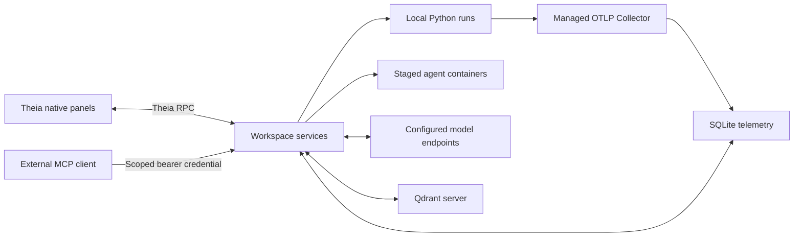

# Implementation status and release gates

## Scope

The repository was built from an empty workspace as a local-first Theia/Electron developer preview. Accounts are optional. Product data lives in the selected project, with secrets in OS credential storage. This document records implemented behavior, not a claim that every milestone has met its release gate.

| Area | Implemented | Remaining or limited |
| --- | --- | --- |
| Desktop foundation | Theia 1.77, Electron, editor, terminals, Git/Python extensions, native engineering panels, macOS packaging | Unsigned Apple Silicon developer build; Linux CI configuration exists but no Linux installation result yet; Windows deferred |
| Project/environment | Versioned YAML, environment/lock detection, six locked templates, staged uv dependency changes and instrumentation helper | Existing applications must wire callbacks; arbitrary environment migrations are not automated |
| Runs | Local commands, cancellation, SQLite history, environment/config/source records, comparison | Environment record describes interpreter/manager/lock presence, not a complete installed-package inventory; artifacts are references, not an immutable registry |
| Models | Ollama/OpenAI-compatible HTTP, feature probes, OS keyring references, pricing, Theia AI model registration | Validated with protocol fixtures; specific local model quality, throughput, and tool reliability need real-model acceptance |
| Observability | Managed authenticated OTLP Collector, traces/logs/scalar metrics, paging, waterfall, code navigation, redaction, retention, budgets, bounded queues, crash restart | OTLP HTTP only; gauge/sum metrics, no full histogram visualization; partial trace detection is advisory, no guaranteed lossless pipeline |
| Agents | Container staging, tools, streaming/cancellation, scoped MCP, audit events, conflict-checked host application | Container policy is not a hardened VM boundary; no dependency prebuild/cache manager, session restoration, or semantic merge UI |
| RAG | Managed/existing Qdrant, txt/md chunking, embeddings, provenance, dimension checks, filtered retrieval, answers, deterministic/model-scored evaluation | No PDF/OCR pipeline, embedding visual map, or transactional collection reindexing; repeated ingestion appends points |
| Framework tracing | LangChain callbacks; LangGraph node metadata and opt-in state; asynchronous SDK parent context | No static graph editor; observed transitions depend on callback metadata and timing; framework compatibility beyond pinned versions is unverified |
| Training | PyTorch/custom-loop SDK, Trainer callback, PyTorch/PEFT/scikit-learn templates, metric/configuration comparisons, checkpoint inspection/resume, reconnectable Linux SSH jobs, read-only W&B runs/history/artifact metadata, process/NVIDIA metrics | Actual GPU/live W&B acceptance, large-model performance, remote source/dependency synchronization, distributed training, and large artifact transfer remain; see [Training guide](training.md) |
| Monitoring | Prometheus range-query connection and Grafana dashboard metadata in Settings; optional redacted HTTPS OTLP export | Native Grafana/Prometheus time-series panel recreation and LangSmith destination-specific acceptance remain; no claimed Grafana parity |
| Additional integrations | Package installation options and adapter-oriented core modules | Formal independently versioned adapter SDK, pgvector/Chroma, TypeScript deep instrumentation remain |

## Code layout

- `apps/desktop`, `apps/browser`: Theia app compositions and build/packaging configuration.
- `packages/theia-extension`: Theia DI contributions, internal JSON-RPC bridge, model registration, React panels.
- `packages/core`: workspace services, SQLite, run lifecycle, telemetry, models, RAG, container policy, MCP, integration changes.
- `python/aiide_sdk`: dependency-free telemetry queue, context propagation, LangChain callback, training helpers.
- `templates`: runnable examples and pinned uv lockfiles.
- `scripts`: resource installation, asset assembly, UI/runtime verification, demo launch.
- `resources/extensions.lock.json`: pinned VSIX origins and hashes.

Internal UI calls use Theia messaging. The MCP server is a separate authenticated loopback boundary. It never exposes the internal generic operation dispatcher. Project commands are user-authorized host processes; all assistant-issued execution goes through the same sandbox used by external agents.

## Validation record

Validated on macOS Apple Silicon with Node 24, Python 3.14 for the dependency-free SDK, uv Python 3.13 for framework templates, and Docker Desktop:

- Core and extension TypeScript builds; Theia frontend/backend/Electron bundling.
- 24 Node tests and eight Python SDK/runtime tests, including real Collector ingestion, persisted traces after reopening, same-port Collector crash recovery, authenticated OTLP and MCP, write failures, source staging, concurrent-edit conflicts, and 10,000-span backend pagination.
- The earlier packaged macOS preview launched successfully with all five bundled editor extensions and passed run-to-trace/source navigation. The 0.2.1 external-agent workflow passed browser UI acceptance; its separate packaged launch was blocked by the already-running installed IDE's single-instance lock. The 0.2.1 DMG checksum is recorded in `dist/0.2.1/SHA256SUMS`.
- End-to-end desktop flow: Run button → local Python process → bundled Collector → SQLite → native trace panel. Browser flow also exercised.
- Real Docker command execution with non-root identity, read-only root, blocked network, command cancellation, absent Docker socket and host credentials; real Qdrant ingestion/retrieval with deterministic embedding fixture.
- macOS Keychain write/read/delete using a disposable credential, plus reviewed uv dependency installation in a temporary LangGraph project.
- A small real scikit-learn classification run and real LangGraph state transition callback using the locked environments.

- Codex CLI configuration parsing and actual Claude Code MCP connection, with isolated test settings and no model inference; native external-session review/apply, Docker commands, conflict protection, and revocation.
- Real CPU PyTorch training with decreasing loss, model/optimizer checkpoint inspection and resume; Transformers Trainer and PEFT template training/resume using a locally generated tiny model.
- Real Linux OpenSSH fixture with listener disconnection, IDE workspace restart, exactly-once metric replay, artifact download, and process-group cancellation.
- Pinned W&B Public API SDK against an authenticated local GraphQL fixture: runs/history pagination, artifact files, redaction, invalid-operation and bad-credential rejection.
- Packaged Electron Training UI through local training/resume, SSH job metrics/status, and W&B history/artifact browsing; fixture credentials created by the app and removed by its backend helper. GPU units/missing-sensor parsing tested with fixtures.

These checks do **not** establish a production load benchmark, a full air-gap/network audit, secure isolation against hostile kernel exploits, all framework version combinations, large-model fine-tuning quality, real GPU or live W&B compatibility, Linux release quality, or macOS signing/notarization.

## Release gates still required

1. Run the complete RAG journey with installed real chat/embedding models and a representative document/evaluation corpus; measure trace arrival and model/tool failure behavior.
2. Clean macOS/Linux install, upgrade, uninstall, keyring, terminal/debugger, and signed/notarized distribution checks; preserve project data throughout.
3. Validate 10,000-span UI responsiveness, documented telemetry throughput/latency, memory/disk bounds, malformed requests, prolonged disk exhaustion, and recovery under contention. Current tests exercise backend pagination and selected failure paths, not the full acceptance workload.
4. Audit offline behavior of bundled third-party extensions. Disable/uninstall any extensions that contact external services in the intended offline configuration; no full offline capture audit has been performed.
5. Security review of staging, Docker configuration, endpoint scopes, token expiry/revocation with in-flight commands, credential redaction, and filesystem race behavior. Review is required before treating untrusted external agents as production-safe.
6. Validate training on actual GPU hardware and a live W&B service; complete the remaining monitoring interfaces in the matrix. Local SSH/API fixture acceptance is implemented and passing.

## Operational limits

- Default telemetry retention: 7 days. Configurable budget: 1–2048 MB. The budget drops new telemetry at the threshold; it is not a hard quota on every workspace artifact, Qdrant, or SQLite metadata file.
- Maximum eight project runs, four staged sessions, two active assistant chats per workspace. Agent commands: two-minute timeout, 1 GB RAM, two CPUs, 128 PIDs, 128 MB temporary filesystem, bounded output, no network unless explicitly granted in the manual agent terminal.
- Known credential names/patterns are excluded from stages; secrets embedded in arbitrary code are not comprehensively detectable. User local runs inherit the user's environment and assigned service credentials. Those credentials are not passed into agent containers.
- Content opt-in applies to telemetry persistence/export. Documents are intentionally stored in the selected vector database; selected assistant context is intentionally sent to the chosen model.
- SQLite schema is versioned and rejects unknown versions. Only schema 1 exists; a forward migration/rollback strategy must be tested when schema 2 is introduced.
- Fine-tuning requires locally available model/tokenizer and JSONL data paths. The template offers explicit framework checkpoint resume via `AIIDE_RESUME_CHECKPOINT`; the IDE does not claim that every checkpoint can resume.
- Bundled Python extensions register the Python/debugpy debugger and use bundled basedpyright. Theia reports unsupported optional extension activation events and harmless English localization-directory warnings; full debugger acceptance remains part of the release gates.
- Prometheus/Grafana connections currently show query results/metadata as structured data. The W&B reader is separate from project package installation and supports read-only metadata/history, not artifact payload download.
- SSH jobs use the remote account's privileges and survive IDE shutdown. Existing remote source/dependencies are required; each remote journal is bounded at 32 MB and retained until explicitly removed. See the training guide for transfer and resume limits.
