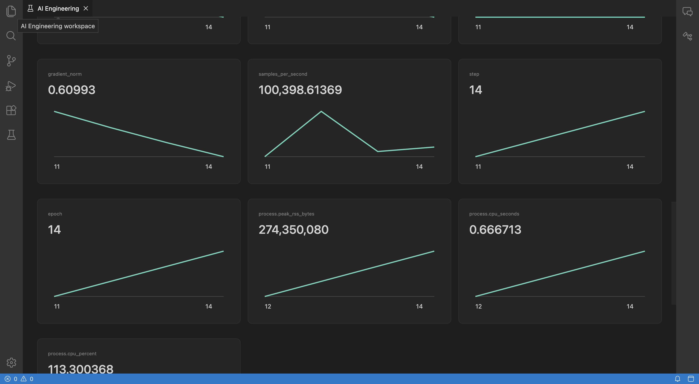

# Training workspace

Preview 0.2 adds local training, reconnectable Linux SSH jobs, and a read-only W&B browser to the native **Training** panel. The existing run store and telemetry pipeline hold training metrics alongside agent and RAG traces.



## Local training and checkpoint resume

1. Create the **PyTorch** template in Overview. Run its `setup` command once to install the locked environment, then open Training.
2. Select the training command, choose **Local**, and enter scalar JSON parameters, for example `{"steps":20,"learning_rate":0.1,"checkpoint_every":10}`.
3. Start training. Select the run to inspect loss, validation loss, learning rate, gradient norm, throughput, process measurements, and checkpoint references. Select a second run to compare parameters and metric curves.
4. Inspect a checkpoint and choose **Use this checkpoint for resume**. Increase the total step count, then choose **Launch resumed training**. The original run stays in history.

The PyTorch example restores model, optimizer, and torch RNG state, checks its checkpoint hash, and continues from the recorded step. It refuses to overwrite an existing checkpoint directory. For a fresh repeat, archive the old checkpoint directory yourself or use a new project. Artifact references point to project files; they are not immutable snapshots.

The fine-tuning template uses Transformers and PEFT with a local model/tokenizer directory and a local JSONL dataset containing `text` fields. Enter both paths in Training. It never downloads model weights implicitly. The model must support causal language modeling and the template's LoRA targets. Resume requires Trainer state, optimizer, scheduler, RNG, and model/adapter files. Missing or incompatible checkpoints remain unavailable. Resume uses the same execution target and saved SSH profile; moving a checkpoint between hosts is not automated.

Custom loops can use:

```python
from aiide_sdk import flush
from aiide_sdk.training import parameters, log_training, log_system

config = parameters({"steps": 100})
for step in range(config["steps"]):
    loss = train_step()
    log_training({"loss": loss}, step)
    log_system(step)
flush()
```

Use `save_checkpoint`/`load_checkpoint` for the supported PyTorch format, or `trainer_callback()` with a Hugging Face Trainer. Declare `training.framework` and `training.resume` in `.aiide/project.yaml`. Custom and scikit-learn projects can record metrics/artifacts without advertising checkpoint resume.

CPU time, CPU percentage, and process RSS are available where the operating system supplies them. NVIDIA utilization, memory, and temperature use `nvidia-smi`; CUDA allocation metrics use PyTorch when available. Missing measurements are shown as unavailable, never fabricated as zero. Apple GPU and distributed worker aggregation are not implemented.

## Linux SSH execution

Prepare an existing project and Python environment on a Linux host. Install project dependencies there using your normal workflow. Establish and verify the server's host key with OpenSSH before connecting through the IDE.

In **SSH connections**, save a host or SSH alias, user/port, absolute remote project directory, and Python executable. Optional identity and known-hosts paths refer to local files; key contents are never stored in project JSON. Test the connection, then choose **SSH** and the profile when launching a training command.

The IDE uses system OpenSSH with strict host-key verification, batch authentication, no agent forwarding, no forwarded ports, and no local command. Your existing SSH configuration can provide aliases and authentication. The remote process runs as the SSH account, with that account's filesystem/network privileges. It is a user-authorized training process, not an autonomous-agent sandbox.

A detached Linux supervisor writes job state and bounded telemetry beneath the remote project's `.aiide/jobs/<run-id>`. Disconnecting SSH or closing the IDE leaves the job running. Reopening the local workspace resumes polling; telemetry and its replay cursor commit together to prevent duplicate replay after a restart. The UI distinguishes the last known job status from a disconnected transport. Cancellation is delivered over SSH and terminates the supervised process group; it cannot take effect while the host is unreachable. An unconfirmed launch is not automatically retried.

Only the small supervisor/SDK and launch configuration are transferred. Source files, datasets, models, and dependencies must already exist remotely. Local model and W&B credentials are not forwarded. Remote provenance records the Git revision when available and hashes command-referenced source files; it is not a complete source/dependency snapshot.

Remote telemetry is redacted before disk persistence, with content capture governed by the project setting. Each job's append-only journal is capped at 32 MB, with a 256 KB record limit and visible drop count. Remote journals are not automatically deleted by local retention. Remove completed job directories deliberately when no longer needed. Polls fetch at most 200 records and 8 MB. Local storage still applies its configured retention/budget.

Artifacts can be inspected remotely. Download a selected file up to 16 MB into the local workspace; large model checkpoints remain on the host. File access is restricted to registered artifact paths beneath the project, and symlink escapes are rejected.

## Read-only Weights & Biases

Expand **Weights & Biases** in Training. Save an API base URL and API key as a W&B connection; keys use the OS credential store. Cloud endpoints require HTTPS. Loopback HTTP is available for local development fixtures.

Choose **Install reader** once. This installs pinned `wandb==0.23.0` in a separate workspace connector environment using `uv`, without changing the project's dependencies. Installation needs access to the locked packages unless already cached. Choose the connection, enter `entity/project`, and load runs.

The panel shows run configuration/summary, metric history charts, logged artifacts, and artifact file metadata. Runs are paginated in groups of 25, history in 500-step windows, and artifact files in groups of 50. Queries are bounded and use the actual W&B Public API SDK. The reader permits only GraphQL queries to the configured endpoint, blocks mutations and redirects, and does not initialize a tracking run. Metadata is fetched on demand rather than imported into the local run database. W&B artifact payload download and cross-service run merging are not implemented.

## Reproduce acceptance tests

From the repository root, with Node 24, uv, Docker, OpenSSH tools, and the bundled Collector installed:

```sh
uv sync --project templates/finetune --locked
npm run build:browser
npm test
npm run test:training
npm run test:wandb
npm run test:training:ui
```

`AIIDE_TRAIN_TEST_PYTHON` can select another interpreter containing the pinned training dependencies. The UI test needs Chrome (`CHROME_PATH` overrides its default macOS path) and an OS keyring. Set `AIIDE_ELECTRON_EXECUTABLE` to the packaged app executable to run the same acceptance flow in Electron instead of the browser target. It creates and deletes a disposable fixture credential. Tests use temporary project directories and remove only their own containers/images. Set `AIIDE_KEEP_TEST_DATA=1` to retain test projects for diagnosis.

The training acceptance test performs real CPU PyTorch training/resume, real Transformers Trainer training/resume, and real PEFT fine-tuning/resume against a locally generated tiny model and dataset. It starts a real Linux OpenSSH server in Docker, interrupts its listener, restarts the IDE workspace, checks exactly-once telemetry replay, downloads an artifact, and cancels a job. The W&B test uses the pinned SDK against a local authenticated GraphQL fixture, including pagination, artifact browsing, authentication failure, and secret redaction. UI acceptance drives native Training and W&B panels through those backend paths.

These fixtures were explicitly selected for this iteration. No live W&B account, remote GPU machine, NVIDIA sensor, distributed training, or large-model benchmark has been tested.

Implementation references: [OpenSSH options](https://man.openbsd.org/ssh.1), [Transformers callbacks](https://huggingface.co/docs/transformers/main_classes/callback), and [pinned W&B Public API source](https://github.com/wandb/wandb/blob/v0.23.0/wandb/apis/public/api.py).
